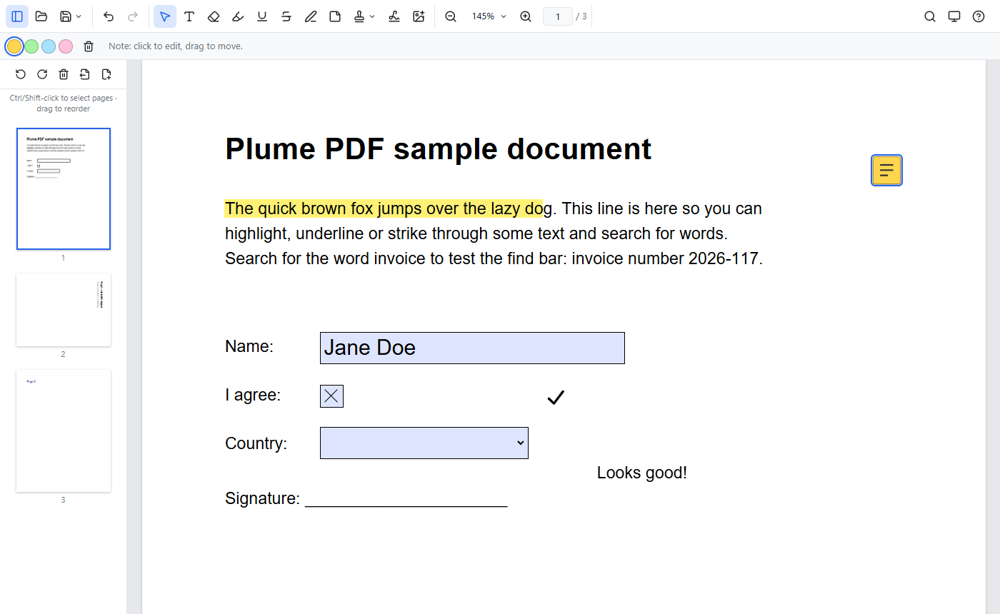

# Plume PDF

**A free, lightweight PDF app for Windows: read, fill in, sign and mark up PDFs without Adobe Acrobat.**

Plume PDF opens instantly, has no account, no ads, no cloud and no subscription. It does the everyday
things people actually use a PDF reader for, and it saves your changes in a way that every other PDF
reader (Acrobat, Edge, Chrome, …) understands.



## What you can do with it

- **Read** – smooth scrolling, zoom, page thumbnails, jump to a page, light or dark theme.
- **Search** – press `Ctrl+F` to find words; every match is highlighted.
- **Fill in forms** – type into fields, tick boxes, pick from lists. The answers are saved in the PDF.
- **Sign** – draw your signature with the mouse, type it in a handwriting font, or use a picture of it.
  Plume remembers it for next time.
- **Add text** anywhere on a page, in any size or color.
- **"Change" existing text** – cover it with a white box and type the new text on top.
- **Highlight, underline or strike through** text.
- **Draw** freehand with a pen.
- **Leave comments** with sticky notes.
- **Stamp** a check mark ✓, a cross ✗, a dot, a circle or today's date.
- **Insert pictures** (PNG, JPEG, and more).
- **Organize pages** – rotate, delete, drag to reorder, pull pages out into a new PDF, or combine
  several PDFs into one.
- **Undo / redo** anything, including page changes.
- **Save a "flattened" copy** – bakes everything into the page so nobody can move or edit your additions.

Press `?` in the app to see all keyboard shortcuts.

## Install

1. Download `Plume-PDF_x.y.z_x64-setup.exe` from the [latest release](../../releases/latest)
   (or build it yourself, see below).
2. Run it. It installs just for you, so you don't need administrator rights.
   The installer isn't code-signed yet, so Windows may show a blue "Windows protected your PC" screen:
   click **More info** → **Run anyway**.

Requires Windows 10 or 11 (64-bit).

### Make it your default PDF app

Windows doesn't let apps make themselves the default, so do this once:
right-click any PDF in File Explorer → **Open with** → **Choose another app** → **Plume PDF** → **Always**.

## Safe by design

- Plume never runs scripts hidden inside a PDF, and never opens attachments or launches programs from one.
- Links in a PDF open in your normal browser, and only after you confirm.
- Your files stay on your computer. Plume doesn't connect to the internet.

## Good to know

- You can't edit a PDF's original text directly. Use a white box plus a text box instead.
- The white box only *hides* text. The original words are still in the file, so don't use it to
  black out confidential information.
- Added text supports Western European languages (English, French, Spanish, German, …).
- Password-protected PDFs can be opened and searched, but not saved with changes.
- Scanned documents (pictures of pages) can't be searched or highlighted yet. Text recognition (OCR)
  is planned.

---

## For developers

Plume PDF is built with [Tauri 2](https://tauri.app) (a small Rust shell using Windows' built-in
WebView2), React, [PDF.js](https://mozilla.github.io/pdf.js/) for rendering, search and forms, and
[pdf-lib](https://pdf-lib.js.org) for saving.

Everything you add is stored as **standard PDF annotations** (FreeText, Highlight, Ink, Stamp, …) with
appearance streams, so it looks the same in other viewers. When you reopen a file saved by Plume, those
items are editable again.

### Build and run

Prerequisites: Node 20+, Rust (stable, MSVC toolchain), Visual Studio C++ Build Tools, WebView2
(preinstalled on Windows 11).

```sh
npm install
npm run app:dev      # desktop app with hot reload
npm run dev          # browser-only mode at http://localhost:1420
npm run app:build    # release build + installer in src-tauri/target/release/bundle/nsis/
npm test             # PDF writer round-trip tests (uses samples/sample.pdf)
```

`scripts/make-sample.ts` regenerates `samples/sample.pdf`.
`scripts/readme-shot.mjs` retakes the README screenshot (with `npm run dev` running and Microsoft Edge installed).

### Project layout

```
src/
  pdf/viewer.ts      PDF.js viewer wrapper (render, text layer, forms, find, zoom) + per-page overlays
  pdf/pdfWrite.ts    writes items as annotations or flattened content; reads them back
  pdf/pageOps.ts     rotate / delete / reorder / merge / extract with pdf-lib
  components/        toolbar, page panel, overlays (editing UI), dialogs
  store.ts           app state, undo/redo
  actions.ts         open / save / page operations
src-tauri/           Rust shell: native file read/write, startup file, file association,
                     navigation and pop-up blocking (src/lib.rs)
```

## License

[MIT](LICENSE): free to use, copy, modify and share, including commercially.
